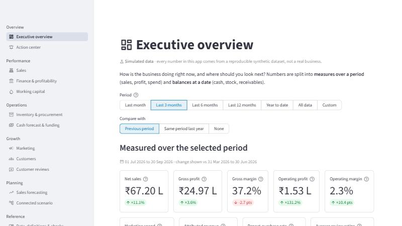
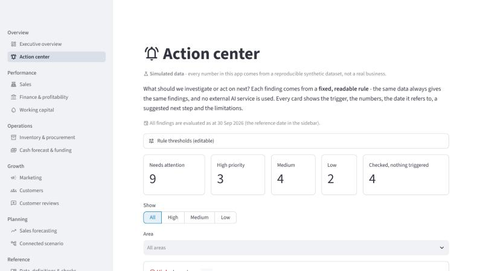
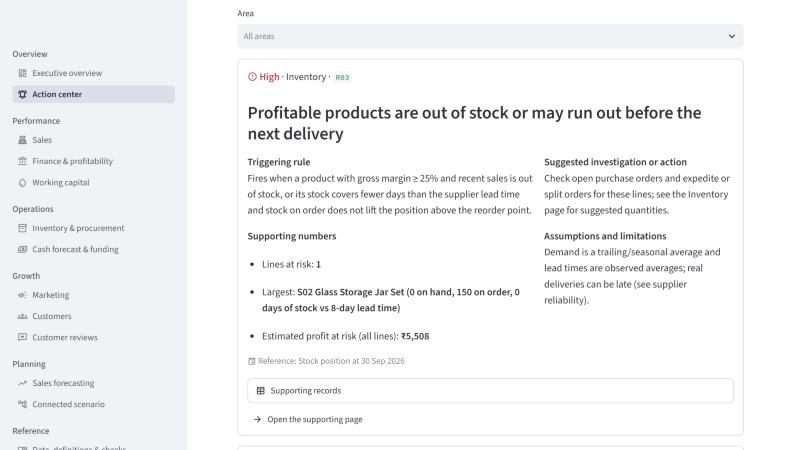
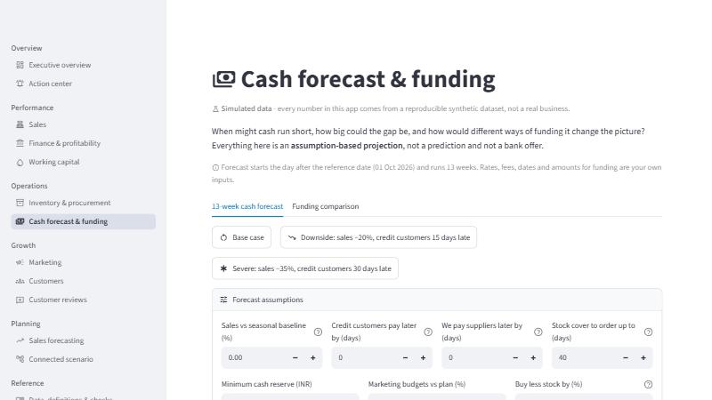
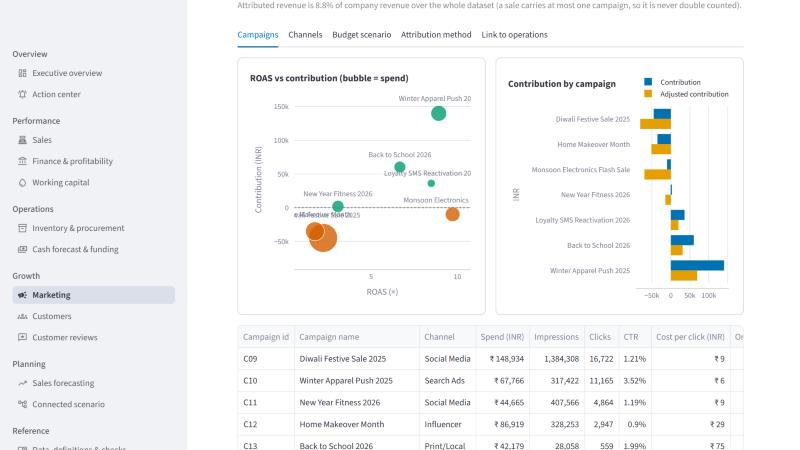

# RetailIQ — Integrated Retail Business Intelligence and Planning Platform

A portfolio project: a local web app (Python + Streamlit) that connects **sales, finance, working capital, inventory, funding, marketing, customers and reviews** for a small two-store retailer, so you can see how a decision in one area ripples into the others.

> **All data is SIMULATED.** There is no real dataset. A seeded generator creates about 24 months of connected, internally consistent data (45,000 sales transactions, purchase orders, payments, loans, campaigns, reviews …). Nothing here describes a real company, and no result should be quoted as a real-world finding. Every page says so.

## Screenshots

Captured from the running app (small, 800×450, because they were taken in a preview pane; the live app is much sharper). Data is simulated.

| | |
|---|---|
|  |  |
|  |  |
|  | |

## What a business owner can ask — and where RetailIQ answers

| Question | Page |
|---|---|
| Are sales growing, and are we actually profitable? | Executive overview · Sales · Finance & profitability |
| Where is our cash going? | Finance → Cash flow (with reconciliation) |
| How much money is tied up in inventory? How much capital do we need to operate and grow? | Working capital (with a what-if tool) |
| Which products need replenishment, and what would an order cost? | Inventory & procurement |
| When might we face a cash shortage? How would a loan or owner investment change things? | Cash forecast & funding |
| Which marketing campaigns produce useful results? | Marketing (ROAS **and** contribution) |
| Which customers return, and which might become inactive? | Customers |
| What do reviews reveal about products and service? | Customer reviews |
| How many units will we sell in the next 7 / 30 days? | Sales forecasting |
| If we spend more on marketing, what happens to stock, purchasing and cash? | Connected scenario |
| What should we investigate next? | Action center |

**How the areas connect** (the point of the project): marketing raises demand → demand changes the stock you need → stock changes purchasing → purchasing (paid after supplier terms) and collections (after customer terms) change cash → the cash forecast shows if a reserve is breached → the funding page compares ways to cover the gap. The *Connected scenario* page lets you walk that chain with every assumption visible.

---

## Setup on Windows (exact steps)

Tested on Windows 11 with **Python 3.13.3 (64-bit)**. You need Python on your PATH — check with `python --version`.
(If `py --version` does not work on your computer, ignore it: this project only uses the `python` command.)

### 1. Get the project into `D:\RetailIQ`

**Option A — clone it from GitHub (recommended; needs [Git for Windows](https://git-scm.com/download/win)):**

```powershell
git clone https://github.com/sudhaakhil/retailiq.git D:\RetailIQ
```

**Option B — download the ZIP:** on the repository page choose *Code → Download ZIP* and extract it. GitHub wraps everything in a folder called `retailiq-main`, so move its contents up until the folder is `D:\RetailIQ` and `streamlit_app.py` sits directly inside it.

Either way, `D:\RetailIQ` should contain `streamlit_app.py`, `retailiq\`, `app_pages\`, `tests\` and `docs\`.

### 2. Open PowerShell in that folder

```powershell
cd D:\RetailIQ
```

### 3. Create the dedicated virtual environment and install packages

This creates `D:\RetailIQ\.venv` and touches nothing else on your computer (your other projects' environments are not affected).

```powershell
python -m venv .venv
.\.venv\Scripts\python.exe -m pip install --upgrade pip
.\.venv\Scripts\python.exe -m pip install -r requirements.txt
```

*Tip:* using `.\.venv\Scripts\python.exe` directly means you never need to "activate" the environment, so PowerShell's script-execution policy cannot get in your way. (If you prefer activating it: `.\.venv\Scripts\Activate.ps1` — if PowerShell refuses, run `Set-ExecutionPolicy -Scope CurrentUser RemoteSigned` once, or just keep using the explicit path.)

### 4. Create the simulated database (about 15–20 seconds)

```powershell
.\.venv\Scripts\python.exe -m retailiq.cli init-db
```

It is safe to repeat: running it again changes nothing. It never overwrites a different dataset (it tells you to use `--reset`, which backs the old file up first).

### 5. Check the data is consistent (optional but recommended)

```powershell
.\.venv\Scripts\python.exe -m retailiq.cli check
```

You should see `[PASS]` lines ending with `All checks passed.`

### 6. Run the automated tests (optional)

```powershell
.\.venv\Scripts\python.exe -m pytest
```

The full suite takes a few minutes (it generates data and renders every page headlessly). Expected: all tests pass — see [docs/verification_report.md](docs/verification_report.md) for the results recorded when this was built.

### 7. Start the app

```powershell
.\.venv\Scripts\python.exe -m streamlit run streamlit_app.py
```

Your browser opens at <http://127.0.0.1:8501> (the terminal prints the exact address). Stop the app with **Ctrl+C** in the PowerShell window.

The app has no login, so `.streamlit\config.toml` makes it listen **only on your own computer** (`127.0.0.1`); other devices on your network cannot open it.

**One-step alternative:** `powershell -ExecutionPolicy Bypass -File scripts\setup.ps1` does steps 3–5, then `powershell -ExecutionPolicy Bypass -File scripts\run.ps1` starts the app.

**No database yet?** If you start the app before step 4, it shows a "Create simulated database now" button — same effect, same safety.

### Using VS Code

*File → Open Folder → `D:\RetailIQ`*, then *Ctrl+Shift+P → "Python: Select Interpreter" → `D:\RetailIQ\.venv\Scripts\python.exe`*. The integrated terminal can then run the commands above.

---

## Using the app

* **Sidebar** (every page): *Reference date* (the "as at" date; defaults to the latest date in the data), *Display currency* (INR by default; other currencies need a conversion rate **you** enter — amounts are never silently mixed), and *Reload data* (clears caches and re-reads the database).
* **Period picker** on most pages: presets (last month … all data) or a custom range, with a comparison against the previous period or the same period last year.
* **Tables** have a *Download CSV* button; every page that shows a figure also lets you reach the supporting records (transactions, movements, reviews, schedules).
* **Metric definitions** are in each page's *"How is this calculated?"* boxes and in [docs/metrics_and_assumptions.md](docs/metrics_and_assumptions.md).

## Project layout

```
RetailIQ/
├─ streamlit_app.py            entry point: navigation + sidebar
├─ app_pages/                  interface pages (one file per page, direct scripts)
├─ retailiq/
│  ├─ config.py                paths, seed, default thresholds
│  ├─ db/                      SQLAlchemy schema (grain + keys per table) and database access
│  ├─ datagen/                 synthetic data: catalog.py (assumptions) + generator.py (daily simulation)
│  ├─ analytics/
│  │   ├─ dataset.py           read-only in-memory view shared by all analytics
│  │   ├─ accounting.py        depreciation, loan amortisation, safe division
│  │   ├─ finance.py           P&L, cash flow, balance sheet, budgets, profitability, break-even
│  │   ├─ capital.py           working capital, days metrics, scenario tool
│  │   ├─ inventory.py         valuation, reorder points, budget prioritisation
│  │   ├─ cashflow.py          13-week forecast engine
│  │   ├─ funding.py           term loan / revolver / owner capital / dilution
│  │   ├─ marketing.py         campaign metrics, attribution check, budget scenario
│  │   ├─ customers.py         repeat rate, RFM, cohorts, inactivity, lifetime value
│  │   ├─ reviews.py           sentiment baseline, themes, trends
│  │   ├─ forecasting.py       seasonal-naive baseline + Ridge model, leakage-safe validation
│  │   ├─ scenarios.py         connected marketing → stock → cash scenario
│  │   └─ actions.py           rule-based Action Center
│  ├─ ui/                      formatting, state, charts, components, cached wrappers
│  └─ cli.py                   init-db / check / export / info
├─ tests/                      pytest suite (data, finance, capital, inventory, funding, cash, marketing, customers, reviews, forecasting, actions, UI)
├─ docs/                       architecture, data dictionary, database diagram, metric definitions, demo script, interview notes, verification report
├─ scripts/                    setup.ps1, run.ps1, generate_docs.py
├─ data/                       retailiq.db (created by init-db; not committed)
└─ requirements.txt / requirements-lock.txt
```

## Command cheat sheet

| Task | Command |
|---|---|
| Create the database | `.\.venv\Scripts\python.exe -m retailiq.cli init-db` |
| Different seed / length | `... init-db --seed 7 --months 18` (needs `--reset` if a database already exists) |
| Replace the database (old one is backed up to `data\backups`) | `... init-db --reset` |
| Integrity checks | `... -m retailiq.cli check` |
| Describe the database | `... -m retailiq.cli info` |
| Export every table to CSV | `... -m retailiq.cli export --out data\exports` |
| Run all tests | `... -m pytest` |
| Run one test file | `... -m pytest tests\test_finance_capital.py` |
| Regenerate data dictionary and diagram | `... scripts\generate_docs.py` |
| Use a different database file | set `$env:RETAILIQ_DB = "D:\somewhere\other.db"` before starting |

## Data safety and reproducibility

* The generator uses a fixed seed (**42**), so the same command always produces identical data (a test proves it).
* `init-db` never overwrites silently: same seed → "nothing changed"; different data → refuses unless `--reset`, which first copies the old file to `data\backups\`.
* Edits you make in the app (for example, the planned-cash-items table) live in your browser session and never change the database.
* Foreign keys are enforced in SQLite; `check` verifies there are no orphan records.

## Using Git

If you cloned the repository, it is already a Git repository connected to GitHub. Make your own changes on a branch so `main` stays clean:

```powershell
git switch -c my-change
git add -A
git commit -m "Describe what you changed"
git push -u origin my-change
```

If you downloaded the ZIP instead, start your own repository with `git init`, `git add .` and `git commit -m "RetailIQ: initial version"`.

`.gitignore` already excludes `.venv`, caches and the generated `data\retailiq.db` (anyone can recreate it with `init-db`).

## Troubleshooting

| Symptom | Fix |
|---|---|
| `python` is not recognised | Reinstall Python 3.13 from python.org with *Add python.exe to PATH* ticked, then reopen PowerShell. |
| `py` does not find Python | Ignore it — use `python` as shown here. |
| PowerShell blocks `Activate.ps1` or the scripts | Use the explicit `.\.venv\Scripts\python.exe` form, or `-ExecutionPolicy Bypass` as shown. |
| "No RetailIQ database was found" in the app | Run step 4, or press the button the app shows. |
| Port 8501 already in use | `... -m streamlit run streamlit_app.py --server.port 8502` |
| The app looks stale after you re-create the data | Press **Reload data** in the sidebar (or restart the app). |
| `pip install` fails behind a proxy/SSL | Install from a network that can reach pypi.org; `requirements-lock.txt` lists every exact version. |
| Low disk space on `C:` | The project, `.venv` and database need roughly 1 GB — keep them on `D:` as above. |

## Honest limits

* The business is simulated. Patterns such as the leaking water bottle or the low-profit electronics promotions were **deliberately built into the simulation** so the analytics have something to find; they are not discoveries.
* Forecasts, funding comparisons and scenarios are **assumption-based projections**, not predictions or advice. Marketing attribution is not proof of causation. The sentiment baseline's agreement with star ratings is inflated because the review text is generated from templates.
* Local use only: no login, no cloud, no paid APIs. PostgreSQL, hosting, authentication and Docker are natural future extensions.

## Documentation index

* [Architecture, database outline and five-week plan](docs/architecture_and_plan.md)
* [Metric definitions and assumptions](docs/metrics_and_assumptions.md)
* [Data dictionary](docs/data_dictionary.md) · [Database diagram](docs/database_diagram.md)
* [Demonstration script (10 minutes)](docs/demo_script.md)
* [Resume description and interview talking points](docs/interview_and_resume.md)
* [Verification report (actual test results and what was not verified)](docs/verification_report.md)
