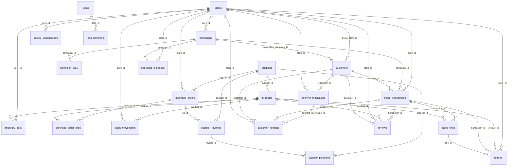

# Database diagram

*Generated by `scripts/generate_docs.py`. The same diagram is drawn interactively on the app's "Data, definitions & checks" page.*

## Entity-relationship diagram (Mermaid)

Open this file in VS Code with the *Markdown Preview Mermaid Support* extension, or paste the block into https://mermaid.live.



## Relationships in words

**Reference data**
- `products` references: `supplier_id` → `suppliers.supplier_id`
- `campaigns` references: `store_id` → `stores.store_id`
- `customers` references: `home_store_id` → `stores.store_id`; `acquisition_campaign_id` → `campaigns.campaign_id`

**Sales and collections**
- `sales_transactions` references: `store_id` → `stores.store_id`; `campaign_id` → `campaigns.campaign_id`; `customer_id` → `customers.customer_id`
- `sales_lines` references: `transaction_id` → `sales_transactions.transaction_id`; `product_id` → `products.product_id`
- `returns` references: `store_id` → `stores.store_id`; `product_id` → `products.product_id`; `transaction_id` → `sales_transactions.transaction_id`; `line_id` → `sales_lines.line_id`
- `opening_receivables` references: `customer_id` → `customers.customer_id`; `store_id` → `stores.store_id`
- `customer_receipts` references: `opening_receivable_id` → `opening_receivables.opening_receivable_id`; `transaction_id` → `sales_transactions.transaction_id`; `customer_id` → `customers.customer_id`; `store_id` → `stores.store_id`

**Procurement and stock**
- `purchase_orders` references: `supplier_id` → `suppliers.supplier_id`; `store_id` → `stores.store_id`
- `purchase_order_lines` references: `po_id` → `purchase_orders.po_id`; `product_id` → `products.product_id`
- `supplier_invoices` references: `supplier_id` → `suppliers.supplier_id`; `po_id` → `purchase_orders.po_id`
- `supplier_payments` references: `supplier_id` → `suppliers.supplier_id`; `invoice_id` → `supplier_invoices.invoice_id`
- `stock_movements` references: `product_id` → `products.product_id`; `store_id` → `stores.store_id`
- `inventory_daily` references: `store_id` → `stores.store_id`; `product_id` → `products.product_id`

**Costs, assets and financing**
- `operating_expenses` references: `store_id` → `stores.store_id`; `campaign_id` → `campaigns.campaign_id`
- `capital_expenditures` references: `store_id` → `stores.store_id`
- `loan_payments` references: `loan_id` → `loans.loan_id`

**Marketing and feedback**
- `campaign_daily` references: `campaign_id` → `campaigns.campaign_id`
- `reviews` references: `transaction_id` → `sales_transactions.transaction_id`; `product_id` → `products.product_id`; `store_id` → `stores.store_id`; `customer_id` → `customers.customer_id`

## How the areas connect

```
customers ──┐                     ┌── campaigns ── campaign_daily (spend, impressions, clicks)
stores ─────┼── sales_transactions ┤
            │        │             └── (campaign_id: ONE campaign per sale = attribution)
products ───┤   sales_lines ── returns
suppliers ──┘        │
   │                 └── stock_movements ── inventory_daily     (sale lines leave stock at weighted-average cost)
   └── purchase_orders ── purchase_order_lines ── stock_movements (receipts enter stock)
            └── supplier_invoices ── supplier_payments           (payables)
customer_receipts (collections)   operating_expenses   capital_expenditures
loans ── loan_payments (interest / principal)   equity_transactions   opening_balances
          └────────── everything that moves cash is summarised in cash_ledger ──────────┘
reviews ── (customer, product, store, transaction)
```
